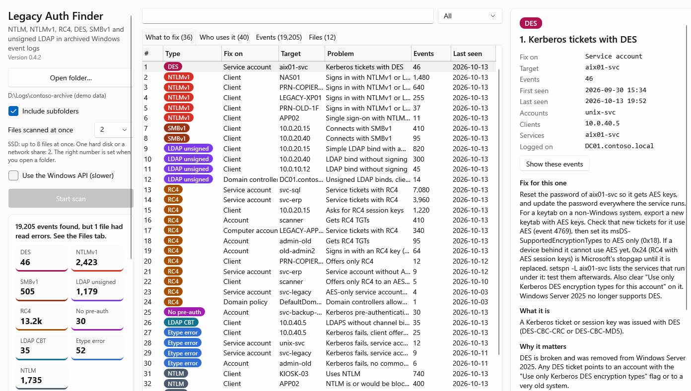
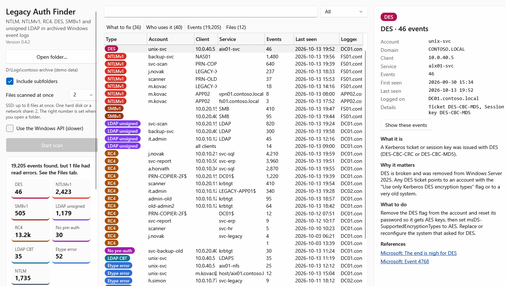
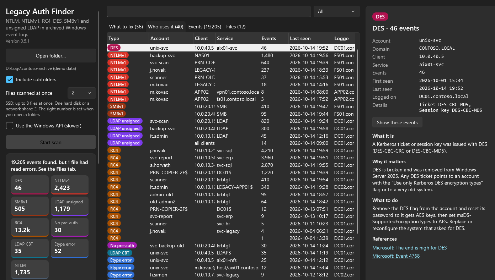
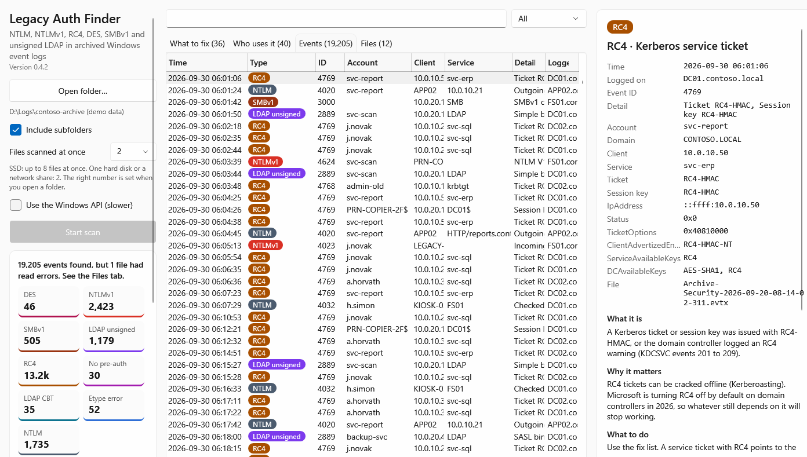
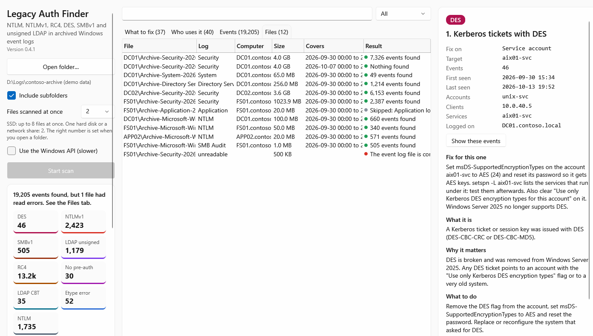

# Legacy Auth Finder


Legacy Auth Finder finds **NTLMv1, RC4, DES, SMBv1, unsigned LDAP and any NTLM use** in archived Windows event logs, plus the Kerberos requests that already fail for lack of a common encryption type and accounts that do not need Kerberos pre-authentication. Point it at a folder of `.evtx` files copied from your servers and domain controllers. It works out which log each file is, then scans the Security, System, Directory Service, NTLM Operational and SMBServer Audit logs when you press Start scan. It turns the findings into a ranked fix list: which client, account or service account to change, and how. You can search everything and export it. Files of 4 GB and more are fine.



<details>
<summary>Who uses it, dark theme, event list and file list</summary>








</details>

The screenshots show the built-in demo data for a made-up domain.

## Why

Microsoft is turning off RC4 for Kerberos on domain controllers in 2026. NTLMv1 and DES should have been gone years ago. Before you enforce anything, you need to know what still depends on them, and the answer is usually buried in gigabytes of archived Security logs. Typical problems:

- Event Viewer struggles with multi-gigabyte archives, and you would need a separate filter for every file.
- PowerShell `Get-WinEvent` works, but you have to write the filters, the parsing and the grouping yourself.
- The useful answer is not a list of events. It is a list of accounts, clients and services to fix.

Legacy Auth Finder does all of that in one pass and gives you that list.

## What it finds

| Type | Where | How it is recognized |
|---|---|---|
| NTLMv1 and LM | Security log, events 4624 and 4625 (any server) | `LmPackageName` is `NTLM V1` or `LM`. Anonymous sessions (ANONYMOUS LOGON) are ignored, as Microsoft recommends. |
| RC4 | Security log, events 4768, 4769, 4770 (domain controllers) | `TicketEncryptionType`, `SessionKeyEncryptionType` or `PreAuthEncryptionType` is `0x17` or `0x18` |
| DES | Security log, events 4768, 4769, 4770 (domain controllers) | `TicketEncryptionType` or `SessionKeyEncryptionType` is `0x1` or `0x3` |
| RC4 warnings | System log, KDCSVC events 201 to 209 (domain controllers) | Added by Microsoft in 2026 for the RC4 phase-out. 201, 203, 206 and 208 point to the client, 202, 204, 207 and 209 to the service account, 205 to the domain setting `DefaultDomainSupportedEncTypes`. |
| No pre-authentication | Security log, event 4768 (domain controllers) | `PreAuthType` is `0`: the account has "Do not require Kerberos preauthentication" set and can be attacked offline (AS-REP roasting) |
| Unsigned LDAP | Directory Service log, events 2889, 2887 and 2888 (domain controllers) | 2889 names the client, the account and the bind type: SASL without signing or a simple bind with a cleartext password. 2887 is the daily count of accepted binds, 2888 of rejected ones. |
| LDAP channel binding | Directory Service log, events 3039, 3040, 3074, 3075 | Clients that connect over LDAPS without a valid channel binding token. 3040 is the daily count. |
| Encryption type errors | System log, KDC events 14, 16, 26, 27, and Security events 4768, 4769, 4771 with status `0xE` | Kerberos requests that failed because client, account and domain controller had no encryption type in common. These are what breaks when RC4 or DES is turned off. Event 16 names the account whose password to reset separately from the requesting user, and the tool uses that one. |
| NTLM use | NTLM Operational log, events 4020 to 4023 (clients and servers), 4030 to 4033 (domain controllers), 4026 and 4027 (would be or was blocked), 8001 to 8004 (audit) and 4001 to 4006 (blocked, 4004 to 4006 on domain controllers) | Any NTLM authentication, with the reason Windows logged: target given as an IP address, SPN not found, duplicate SPN, local account and so on. NTLM version 1 in these events, and event 4013 (NTLMv1 single sign-on blocked by Credential Guard), count as NTLMv1. |
| NTLM on domain controllers | Security log, event 4776 (domain controllers) | Every NTLM credential validation, with account and workstation. Useful where the enhanced NTLM events do not exist yet. A 4776 for a sign-in or unlock at the computer itself (member servers log those for local accounts) is left out. |
| NTLMv1 single sign-on | NTLM Operational log, events 4024 and 4025 | Wi-Fi, wired or VPN profiles (MS-CHAPv2) that use NTLMv1-derived credentials. They stop working when `BlockNtlmv1SSO` is enforced. |
| SMBv1 | SMBServer Audit log, event 3000 (file servers) | Clients that still connect with SMB version 1 |

Newer domain controllers also log `ClientAdvertizedEncryptionTypes`, `ServiceAvailableKeys` and related fields in 4768 and 4769. The tool shows them in the detail pane. They tell you whether the client or the service account is the reason RC4 was used.

**Auditing must be on.** "Copy logging check" in the app copies a PowerShell check for that, `legacy-auth-scan --logging-check` prints it. Paste it into PowerShell (Run as administrator) on each server and domain controller. It shows what is logged, what is missing and how to turn it on. It only reads: audit policy, registry values and event log settings, nothing is changed. It runs on Windows Server 2016 and newer with the built-in Windows PowerShell 5.1, also on locked-down servers in Constrained Language Mode, and needs nothing installed. For logs in AutoBackup mode it also lists the archive files Windows writes next to them (count, size, how often a new one starts) and the free space of that disk, because Windows never deletes those archives. The details:
- NTLMv1 shows up only when "Audit Logon" success is enabled on the server.
- RC4, DES, missing pre-authentication and the `0xE` failures show up only when "Audit Kerberos Authentication Service" and "Audit Kerberos Service Ticket Operations" are enabled on the domain controllers (failure auditing for the `0xE` events). Status `0xE` in event 4769 is logged only when `KdcExtraLogLevel` includes `0x10`.
- Event 4776 needs "Audit Credential Validation" on the domain controllers.
- Event 2889 needs the "16 LDAP Interface Events" diagnostic value set to 2 on the domain controllers. Without it you only get the daily summary 2887, which tells you that unsigned binds happen but not who makes them.
- Channel binding events appear only when the domain controller's channel binding policy is set to "When supported" or "Always". 3039, 3074 and 3075 also need "16 LDAP Interface Events" set to 2.
- The enhanced NTLM events 4020 to 4033 exist on Windows 11 24H2 and Windows Server 2025, and on Server 2019 and 2022 with the October 2026 updates. "NTLM Enhanced Logging" and "Log Enhanced Domain-wide NTLM Logs" are on by default. Events 8001 to 8004 appear when a "Network security: Restrict NTLM" policy is set to audit.
- SMBv1 event 3000 needs `Set-SmbServerConfiguration -AuditSmb1Access $true` on the file server.
- The NTLM Operational and SMBServer Audit logs are small by default. Export or archive them regularly, or enlarge them, if you want weeks of history.

## How it works

1. **Inventory.** When you open a folder, every `.evtx` file in it and its subfolders is opened and its first record tells which log it belongs to. File names like `Archive-Security-...` are not trusted. Unreadable or damaged files are listed with the reason. Nothing is scanned yet, so you can check the file list first.
2. **Scan.** Press Start scan. The tool reads the `.evtx` files itself with a built-in parser: it streams each file once, in 4 MB blocks, and answers all questions for that log in the same pass. A record is only decoded in full when its event ID is one the tool looks for, so a 4 GB file is never loaded into memory and the disk reads it from start to end. Damaged parts of a file are skipped and the rest is still read, but the file is marked as partly read and the result as incomplete, because the missing part can hold findings. The same goes for a copy that was cut off. A full log copied while Windows was writing to it often has a stale file header: the tool finds the real oldest and newest records from the record numbers. Files that are not `.evtx` files at all go to the Windows event log API instead.
   - **Why not the Windows API?** With the Windows API, the Windows Event Log service opens and filters every file. It needs one pass per question and has to evaluate the filter for every record. On a domain controller archive of 99 GB it ran at about 12 MB per second per file for the RC4 question, so a scan took the better part of an hour. The built-in reader is limited by the disk instead. "Use the Windows API" in the app, or `--windows-api`, switches back for comparison.
   - **Same results.** The tests compare the parser with the Windows API on real exported logs, record by record: event ID, provider, time, computer, channel and every value, formatted the same way, and the values as the event XML shows them. On the CI runner this includes the Security log.
   - **Overlapping exports.** When two files cover the same records of the same log on the same computer, for example a daily and a weekly export, every event is counted once. Records are matched by record ID and time, only where the files' record ranges and time ranges overlap: record IDs start again at 1 after a log is cleared or a domain controller is rebuilt, and an old archive next to a new log must not lose events. The number of skipped duplicates is shown with the results.
3. **Files at once.** When you open a folder, the tool checks what kind of disk it is on and picks the number of files to scan in parallel: up to 8 on an SSD, 2 on a hard disk, a network share or a disk whose type cannot be detected. You can change it, but on one hard disk more files at once make the disk seek between them and the whole scan slower.
4. **Results.**
   - **What to fix** turns the findings into a ranked list of things to change: the client, the account, the service account, a computer account, a server, the domain controllers or the domain policy, with the concrete step. RC4 service tickets point to the service account (`setspn -L <account>` lists its SPNs, `setspn -Q <SPN>` finds the account behind an SPN), RC4 TGTs to the account without AES keys or to krbtgt, RC4 session keys and RC4 offers to the client, `0xE` failures to the side without AES keys (a failed service ticket to the target service, never to the user who asked for it), NTLM to the reason Windows logged. Service accounts get the steps in a safe order: new password and keytab with AES keys first, AES only after that. Names ending in `$` get the advice for both computer accounts and managed service accounts (gMSA). The most urgent types come first.
   - **Who uses it** groups the events by type, account, client and service, with counts and first and last seen. Each KDCSVC warning event (201 to 209) gets its own row, because they point to different parties. When the same account name appears in two domains, the fix says so.
   - **Events** lists every single event and is searchable.
   - **Files** shows the detected log, the computer, the time range and the result of each file, and how busy each server is: events per day, and how much history a log of 32 MB, 100 MB, 250 MB or 1 GB would hold at that load. Click a file for the numbers. The estimate comes from the time the file covers, each file on its own, and is marked as rough when the file covers less than a day.

With the built-in reader the disk sets the pace. On an SSD several files at once keep it busy, on a hard disk or a network share 2 files at once is best because each file is read from start to end. Very large results are handled too: the event list keeps the newest 2 million events (fewer on a machine with little memory), and the summary and totals always count all of them. Files hand their events over in batches, so the memory stays near that limit however many files run at once. A file with read errors is marked as an error and the results say they are incomplete.

## Searching

Type one or more words into the search box. A row matches when every word appears in the account, client, service, server, file or type. For example, `sql01 10.0.10.21` shows the RC4 tickets of one client for one SQL server. Double-click a fix or a summary row, or use "Show these events", to see exactly its events: same type, account, client and service. "Show all" or a new search shows everything again. Ctrl+F jumps to the search box.

## Export

The buttons marked "(shown)" export exactly what you currently see: after search and type filter, in the sort order of the list. "(all)" exports the whole fix list, summary, totals and file list as an HTML report or JSON. In the HTML report every fix opens with a click: the steps, what the problem is and why it matters with links to Microsoft, the accounts, clients and servers involved, and the newest events behind it (up to 50 per fix, 20,000 in the report) with all their details, file and record ID. Each summary row links to its fix. JSON has no single events. The HTML report shows up to 1,000 rows per list. For every single event, export "Events as CSV" with no search active, or use `--events-csv` on the command line. CSV files use the list separator of your Windows region, so they open correctly in Excel (`;` in most of Europe). The command line uses `,` unless you give `--csv-separator`.

## Diagnostic log

Every session writes a diagnostic log to `%LOCALAPPDATA%\LegacyAuthFinder\Logs` (the newest 20 are kept). "Open log folder" in the app selects the current file. It records the disk type, every file with its size and record range, how long each file took (speed, chunks, records, damaged parts), and every 10 seconds the state of each running file: what it is doing, how much of it is read, and how busy this process and the Windows Event Log service are (CPU, disk reads, threads). A file without progress for 15 seconds is marked `STALL`. The log never contains account names, client addresses or other event content, only file names and timings. If a scan gets stuck or crawls, this file shows where.

## Download

The version is shown in the window title and in the side panel.

Grab `LegacyAuthFinder-win-x64.zip` from the [latest release](https://github.com/JW-0042/win-legacy-auth-finder/releases/latest). It contains two self-contained executables, so no .NET install is needed:

| File | What it is |
|---|---|
| `LegacyAuthFinder.exe` | Desktop app (WPF, follows the Windows light or dark theme). You can drop a folder onto the window. |
| `legacy-auth-scan.exe` | Command line version for scripts and scheduled reports |

No admin rights are needed to read copied `.evtx` files. GitHub Actions builds every release and adds a signed build provenance attestation. See [SECURITY.md](SECURITY.md) for how to verify a download.

## Command line

```
legacy-auth-scan --logging-check > check.ps1
legacy-auth-scan <folder> [--no-recurse] [--threads <1-64>] [--events-csv <file>] [--summary-csv <file>] [--fix-csv <file>] [--json <file>] [--html <file>] [--csv-separator <, ; | tab>] [--log <file> | --no-log] [--windows-api] [--quiet]
```

`--logging-check` prints the read-only PowerShell check described under "Auditing must be on". The command line writes the same diagnostic log as the app, to the default folder or to `--log <file>`. Output paths are checked before the scan starts, also whether an existing file is read-only or still open in Excel, so a typo does not cost you a long scan. `--csv-separator` takes `,`, `;`, `|` or `tab`. Ctrl+C during the scan stops it and reports what was found so far.

| Exit code | Meaning |
|---|---|
| 0 | Nothing found |
| 1 | Legacy authentication found (any type, NTLM included) |
| 2 | Invalid arguments |
| 3 | No readable Security, System, Directory Service, NTLM Operational or SMBServer Audit logs in the folder |
| 4 | Nothing found, but the scan is incomplete: cancelled, or some files had read errors. Findings in an incomplete scan still return 1, with a warning. |
| 5 | An export file could not be written |

Example:

```
legacy-auth-scan \\fileserver\logs\2026-09 --fix-csv todo.csv --html report.html
```

## Build from source

You need the .NET 10 SDK on Windows.

```
dotnet build LegacyAuthFinder.slnx
dotnet test LegacyAuthFinder.slnx
dotnet run --project src/LegacyAuthFinder.App
```

## Project layout

```
src/LegacyAuthFinder.Core     .evtx parser, file inventory, queries, classification, summary, fix list, diagnostic log, demo data, reports
src/LegacyAuthFinder.App      WPF desktop app (MVVM, Fluent theme)
src/LegacyAuthFinder.Cli      command line front end
tests/LegacyAuthFinder.Tests  unit tests plus integration tests against real exported logs
```

The tool reads files through one interface, `IEvtxReader`, with two implementations: the built-in parser (`EvtxFileReader`) and the Windows event log API (`WindowsEvtxReader`). The unit tests use a fake reader. The integration tests export the System, Application, PowerShell and Setup logs of the machine they run on, and on CI also the Security log, and check that both readers return exactly the same records and values. The demo data runs through the real scanner and summary, only the file reading is simulated.

## How this was built

I designed and wrote this tool together with an AI coding agent (Claude Code), the same way as [Hardening Checker](https://github.com/JW-0042/win-hardening-checker) and [Event Triage](https://github.com/JW-0042/win-event-triage). The full story is in [docs/how-this-was-built.md](docs/how-this-was-built.md).

## Disclaimer

Event logs only show what was audited and kept. If auditing was off or the archives do not cover a full business cycle (month-end jobs, quarterly reports), something can still depend on RC4 or NTLMv1. Use the KDCSVC audit events and a test period before you enforce.

## Author

Jozef Walterstein, consultant for AI, automation and security. [walterstein.eu](https://walterstein.eu)

License: [MIT](LICENSE)
